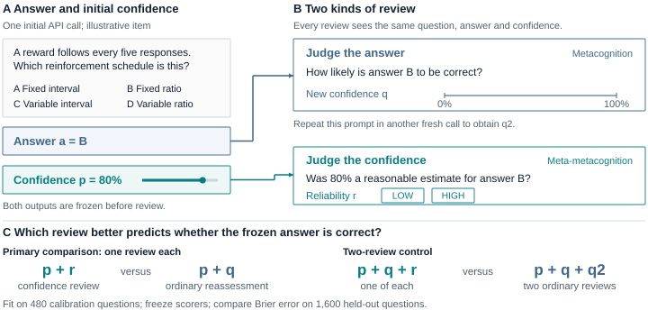

# A Second Thought About Confidence

### Evaluating Higher-Order Confidence Judgments in an LLM

**Pau Kraus · November 2026**

This project was developed for [Apart Research’s AI × Epistemics Research Sprint](https://apartresearch.com/sprints/ai-x-epistemics-research-sprint-2026-11-13-to-2026-11-15), held November 13–15, 2026. It addresses **Track 1: Model Epistemics & Decision-Making Evals**, investigating whether reviewing an LLM’s confidence provides useful information about the reliability of its answers.

AI systems increasingly advise people and make decisions on their behalf. A central question is whether they can recognize the limits of their own knowledge and judge when their own sense of certainty is unreliable.

Human research studies assessments of one's own thinking as metacognition, and judgments about the quality of one's confidence as meta-metacognition. We investigate the latter through a concrete behavioral test: does asking an LLM to judge whether its confidence is warranted help identify its mistakes beyond asking it to reconsider the answer?

[Read the paper](A%20Second%20Thought%20About%20Confidence.pdf) · [Methods and reproducibility](docs/REPRODUCIBILITY.md) · [Exact prompt examples](docs/PROMPTS.md)

## The experiment

We froze an LLM's answers and confidence reports, then asked it either to **reassess the answer** or **judge whether its original confidence was reliable**. A second reassessment provided a control for spending an additional review call. Every review received the same information; no review saw another review's output or the correct answer.



- **Model:** DeepSeek Flash, non-thinking mode, temperature 0.
- **Questions:** MMLU-Pro, four subjects: biology, economics, engineering and psychology.
- **Splits:** 480 calibration, 160 development, 1,600 held-out evaluation items.
- **Outcome:** How well each combination of confidence signals predicts whether the frozen answer is correct, using scoring models fitted only on calibration data.

## What we found

**Reviewing confidence added information beyond the original confidence report. It did not establish an advantage over ordinary answer reassessment.**

| Signals used by the scoring model | Evaluation Brier score ↓ |
|---|---:|
| Original confidence | 0.16749 |
| Original confidence + reassessment | 0.16356 |
| Original confidence + reliability judgment | 0.15961 |
| Original confidence + reassessment + reliability | 0.15832 |
| Original confidence + two reassessments | 0.16354 |

The primary comparison—reliability review versus reassessment—was inconclusive. Combining the two review types improved the point estimate, but that advantage remained uncertain when variability in fitting the scoring models was included. The secondary improvement over original confidence alone survived that sensitivity analysis.

This is evidence for useful later self-evaluation in the tested model. It does **not** establish privileged introspection or a distinct meta-metacognitive mechanism. Reviews could partly work by reconsidering the answer.

## Reproduce the results

**No API key, provider access, or paid calls are needed.** Use Python 3.10–3.12; the numerical dependency versions are pinned.

```sh
git clone https://github.com/PausResearch/llm-confidence-review.git
cd llm-confidence-review
python3 -m venv .venv
source .venv/bin/activate
pip install -r requirements.txt
python -m unittest discover -s tests
python reproduce_results.py
```

The script verifies file hashes, evaluation membership, split separation and frozen-model provenance. It reproduces the scores and 5,000-replicate conditional bootstrap intervals, checks them against the saved results, and writes to `reproduced/`.

To also reproduce the post-hoc refit sensitivity analysis and descriptive group checks:

```sh
python reproduce_results.py --refit --groups
```

This adds 2,000 bootstrap refits and uses only local CPU time. Original observations, fitted models and saved results remain unchanged.

## What's included

| Path | Contents |
|---|---|
| `diagnostics/item_confidence*.py` | Original final-experiment prompts, collection and analysis code |
| `auditstudy/` | Original shared data, provider, storage and analysis dependencies |
| `tests/` | Tests for prompts, leakage safeguards, storage and statistics |
| `results/` | Recorded numerical signals, frozen models, protocols and results |
| `docs/` | Methods, data dictionary, reproducibility notes and exact prompt examples |
| `figures/` | Three vector figures and the plotted numerical values |
| `sprint_report.md` and PDF | Full report |

The original collection modules are preserved byte-for-byte for provenance. They depended on staged local databases and are not the offline reproduction entry point. Some shared modules retain earlier pilot functions because the final collection code imports them; abandoned experiment entry points and their outputs are omitted.

Credentials, environment files, raw API logs, databases, local environments, question-text caches and draft reports are excluded. The documented reproduction commands do not load credentials or call a model.

## Scope and data source

The questions come from [TIGER-Lab/MMLU-Pro](https://huggingface.co/datasets/TIGER-Lab/MMLU-Pro), revision `b189ec765aa7ed75c8acfea42df31fdae71f97be`. The repository contains numerical observations and item IDs; obtain question text from the upstream dataset under its terms.

This study tests one model alias, four subjects, and one set of prompt wordings. “Held out” means unused during this study's development, not unseen during pretraining. See the paper for prior research, statistical qualifications and limitations.
