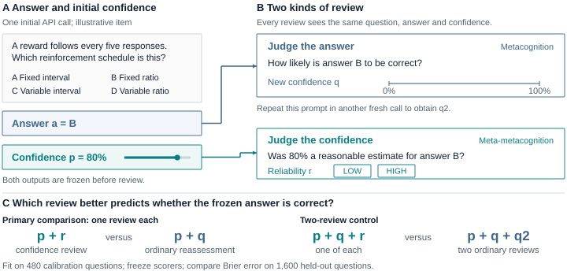
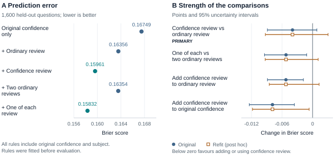

# A Second Thought About Confidence

*Evaluating Higher-Order Confidence Judgments in an LLM*

**Pau Kraus**

AI × Epistemics Research Sprint · 16 November 2026

## Abstract

AI systems increasingly support decisions and act on people's behalf. Recognizing the limits of their knowledge could help prevent unsupported conclusions from guiding action. Yet it remains unclear how reliably LLMs can assess these limits. Human metacognition research distinguishes answering a question from assessing whether the answer is correct. Meta-metacognition examines judgments about the reliability of one's own confidence. We use this framework to test whether an LLM can give useful warnings about confidence it previously expressed. Using DeepSeek Flash, we compare confidence review with ordinary answer reassessment on 1,600 held-out questions across four subjects, keeping answers and available information fixed. In a secondary comparison, confidence review improved prediction of correctness beyond original confidence alone. This improvement remained when we accounted for uncertainty in fitting the scoring rules. The model's initial confidence was therefore an incomplete guide to its answers' reliability: a later review supplied additional information useful for identifying mistakes. Our primary comparison did not establish that confidence review outperforms ordinary reassessment, and the benefit of combining them remained uncertain. These findings support useful later self-evaluation in this model, without establishing a distinct meta-metacognitive mechanism. They motivate further testing of confidence review as a way to flag answers for independent checking.

## 1 Introduction

AI systems are increasingly used to support human decisions and to make decisions on people's behalf. As this role grows, it matters whether they can recognize when their knowledge is sufficient for a decision and when it is not. Recognizing a gap in understanding could help an agent seek more evidence or warn a user that a recommendation needs checking. We still have an incomplete understanding of how reliably LLMs can make these judgments.

Psychological research provides a framework for studying this ability. Work on **metacognition** examines how people assess their own knowledge and reasoning, and how those assessments guide what they do. It distinguishes **monitoring**, such as judging how likely an answer is to be correct, from **control**, such as deciding to check it [1]. This distinction helps us specify what we are testing: whether a model's self-assessments provide useful information about its performance, before asking whether it acts on them appropriately.

Confidence reports give us one way to study this through observable behavior. We can ask a model how likely its answer is to be correct and compare that assessment with actual outcomes. Previous research has found useful confidence signals, but their reliability varies across tasks and methods. They can also reflect question difficulty rather than knowledge of the model's own limits [4, 5, 8].

Human research also asks whether people can assess the quality of their own confidence judgments. This is **meta-metacognition** [2, 3] (Figure 1). Applied to LLMs, it suggests a further test: whether a model's judgment about its earlier confidence helps us evaluate its answer. If useful, such a judgment could flag when the original confidence report is a poor basis for relying on the model's advice.

Our experiment asks:

**Does asking an AI to judge its own confidence help us spot mistakes better than asking it to reassess its answer?**

We record an answer and its confidence, then compare two reviews: “Was that confidence reasonable?” and “How likely is that answer to be correct?” Both evaluate the same recorded answer and neither can change it. Answer keys let us check whether each review helps predict mistakes.

<!-- pagebreak -->

## 2 What Previous Research Tells Us

*Figure 1. Conceptual framework from human research [1–3]. Arrows point to what each judgment assesses. These are different judgment targets, without assuming separate internal mechanisms. Dashed arrows indicate a possible use in decision-making, beyond what we tested.*

### 2.1 Human judgments about confidence

Recht and colleagues studied judgments about confidence in visual perception tasks [2]. Participants assessed their decisions, then assessed those assessments, extending to a fourth level. Later reports carried information about earlier judgments. This provides a behavioral test of meta-metacognition: does the extra assessment tell us something useful?

Zheng, Recht and Rahnev asked whether this requires a distinct process [3]. A two-choice confidence judgment followed by a two-choice judgment about its quality behaved like a single four-level confidence rating. Judging confidence may therefore refine the original assessment rather than reveal a separate ability.

This motivates our comparison with ordinary reassessment: does judging confidence help more than reconsidering correctness? We adapt this reasoning, without replicating the human visual tasks.

### 2.2 What an AI confidence report can tell us

**Verbalized confidence** is certainty reported in words or numbers. Tian and colleagues found it often matched accuracy better than probabilities attached to generated text [4]. Xiong and colleagues found frequent overconfidence and variation across tasks and elicitation methods [5]. Their Self-Probing method assesses a fixed answer in a fresh conversation, a precedent for our ordinary review.

Yang and colleagues elicited uncertainty about probabilities themselves, using ranges and related representations [6]. We instead ask whether a judgment about an earlier confidence percentage helps identify mistakes.

Kumaran and colleagues manipulated internal confidence-related signals in Gemma 3 27B, changing whether it answered or abstained [7]. This connects uncertainty assessment to action. We study API reports, without inspecting internal signals.

Across 20 models and six benchmarks, Moran and Whiting found no relationship between confidence and a model's distinctive performance after their controls [8]. Useful confidence may reflect recognizable question difficulty rather than knowledge specific to the model's own limitations.

### 2.3 The question our study adds

We compare confidence review with ordinary reassessment on the same frozen answers, using identical information. We measure how much each helps predict correctness.

Our **main hypothesis** is that confidence review helps more when each review is combined with original confidence. Comparing one review of each kind with two ordinary reviews controls for the number of requests. Further comparisons measure what confidence review adds to original confidence and to one ordinary review.

This tests whether meta-metacognitive judgments help identify which answers deserve trust.

<!-- pagebreak -->

## 3 How We Tested It

### 3.1 Dataset and model

We used MMLU-Pro, a public multiple-choice benchmark with answer keys [9]. We selected biology, economics, engineering and psychology. Across these subjects, we used 480 questions for calibration, 160 for development and 1,600 for evaluation; each split was balanced by subject. Evaluation questions were held out during study development.

We removed duplicates and shuffled options where wording allowed (Appendix A). These public questions may have appeared in training.

We used `deepseek-flash` in non-thinking mode at temperature zero; the alias does not guarantee a fixed model over time. Each answer and confidence report was frozen, then reviewed in three fresh API calls (Figure 2).

*Figure 2. Illustrative item and simplified prompts. Arrows identify the judgment targets, following distinctions in human experiments [2,3]. Every review receives the full frozen record, without answer keys or other reviews. Scales depict the requested outputs, returned as JSON. All scoring rules also include subject.*

### 3.2 What the confidence review asks

HIGH means the original percentage looks reasonable; LOW means it likely overstates or understates support. An appropriate “50% sure” can receive HIGH, while an unjustified “99% sure” can receive LOW. The label concerns confidence, not correctness. Appendix A gives the instruction.

Reviews assess the frozen answer even if the model would now choose differently. They have no tools or feedback, share a 128-token output limit and are interleaved to reduce timing differences. Separate calls and matching limits do not guarantee independent reasoning or equal computation.

### 3.3 Checking whether the reviews help

We test five ways of predicting whether an answer is correct. All use original confidence and subject; four add a confidence review, an ordinary review, one of each, or two ordinary reviews. Using the 480 calibration questions and their answer keys, we learn how to turn each combination of reports into a probability of correctness. We then apply these scoring rules unchanged to the 1,600 evaluation questions. The language model itself is not trained.

Our main measure is **Brier score**, the average squared error of predicted probabilities [10]. Lower is better. An 80% prediction has error 0.04 if right and 0.64 if wrong. This measures overall probability prediction, not overconfidence alone. Appendix A gives statistical details.

Prompts, fitted rules and the analysis plan were saved before evaluation, as a local record rather than an external preregistration. Evaluation answer keys were used for scoring after all model calls finished.

<!-- pagebreak -->

### 3.4 How we judged the strength of the evidence

The main comparison gives each method one review; the second compares one review of each kind with two ordinary reviews. All methods use original confidence. In Figure 3B, negative differences favor confidence review. Our plan required a clear primary benefit before confirming the combined-review claim. Favorable secondary findings cannot replace an inconclusive primary result.

We estimated 95% uncertainty intervals by repeatedly resampling evaluation questions within each subject: 5,000 repetitions, with fitted scoring rules held fixed. This is called bootstrapping. An interval crossing zero leaves the direction of the difference unresolved.

A post-hoc check used 2,000 repetitions, resampling both calibration and evaluation questions within each subject and refitting the rules on calibration data only. This includes uncertainty from the examples used to interpret the reports. It does not replace the original analysis. Neither procedure generated new model responses. We also examined subject and confidence groups.

## 4 What We Found

### 4.1 No clear advantage over ordinary review

All 1,600 evaluation records were complete. The model answered 1,146 correctly, an accuracy of **71.6%**, while mean original confidence was **77.5%**. It rated 1,012 confidence reports HIGH, or 63.3%.

Confidence review yielded a lower Brier score than ordinary review: 0.15961 versus 0.16356. The difference was −0.00395, with a 95% interval of [−0.00888, +0.00084]. Because the interval includes zero, the primary comparison is inconclusive; it establishes neither superiority nor equivalence.

*Figure 3. A: held-out Brier scores; lower is better. B: all four planned comparisons. Blue circles show original intervals; open amber squares show post-hoc intervals that also vary calibration data. Both use the original point estimates. Intervals crossing zero leave the advantage unresolved. All rules include original confidence and subject.*

### 4.2 Useful information beyond original confidence

Adding confidence review reduced Brier score from 0.16749 to 0.15961 compared with original confidence already adjusted on the 480 calibration questions. This secondary improvement retained an interval below zero when we resampled the calibration data and refitted the scoring rules.

Using one review of each kind produced the lowest error, 0.15832, compared with 0.16354 for two ordinary reviews. The original analysis favored the combination, but the main hypothesis had not been confirmed. The advantage also became uncertain when we varied the calibration examples: the revised intervals included zero. All 2,000 refitting repetitions succeeded. Combining the reviews is worth further study, but the evidence does not yet establish its advantage.

<!-- pagebreak -->

### 4.3 What a LOW reliability label identified

We next looked at what HIGH and LOW ratings meant in practice. Table 1 shows answers that initially received at least 80% confidence, divided by their later confidence-review rating. The confidence bands were defined before evaluation; the later checks of uncertainty within these groups were post hoc.

*Table 1. Initially high-confidence answers. “Confidence / accuracy” gives mean original confidence and observed accuracy. Groups are not matched at identical confidence values.*

| Subject | HIGH n | HIGH confidence / accuracy | LOW n | LOW confidence / accuracy |
| --- | ---: | --- | ---: | --- |
| Biology | 275 | 95.2% / 93.1% | 38 | 94.2% / 65.8% |
| Economics | 224 | 94.7% / 88.8% | 48 | 94.9% / 68.8% |
| Engineering | 48 | 95.4% / 81.3% | 35 | 96.0% / 54.3% |
| Psychology | 228 | 93.2% / 90.8% | 18 | 91.7% / 83.3% |

In biology, both groups originally reported around 95% confidence. Yet the HIGH group was correct 93.1% of the time, compared with 65.8% for the LOW group. The later judgment separated groups whose average initial confidence was very similar. In all four subjects, HIGH groups had smaller differences between average confidence and actual accuracy.

This makes the possible value easy to see: some answers that sounded very certain later received a warning, and those answers were more often wrong. But these groups were not matched at exactly the same confidence levels. Group sizes differ, psychology has only 18 LOW cases, and patterns at lower confidence levels were mixed. Seven of the full 24 subject-by-confidence-by-rating groups had fewer than 20 questions. All groups are retained in the analysis. This is an illustration, not a separate confirmation of the hypothesis.

### 4.4 Selecting which answers to accept

We also used the scores to select the 800 answers judged most likely to be correct. The rule using one review of each kind selected 76 wrong answers; the rule using two ordinary reviews selected 95. That is 90.5% versus 88.1% accuracy among accepted answers. When accepting 90% of all answers instead, the ordering reversed slightly, with 350 versus 345 errors. The practical benefit depends on how many answers are accepted. This illustrates answer screening; it does not establish better decisions by real users.

The two ordinary reviews returned identical percentages on 78.75% of questions. Repeating the same prompt at temperature zero often supplied no new number. A comparison using differently worded ordinary reviews could therefore be more demanding than the repeated-review comparison tested here.

## 5 Discussion and Limitations

### 5.1 What this tells us about meta-metacognition

The clearest finding is that the model's original confidence did not exhaust the useful information available through later self-evaluation. Asking it to review that confidence improved our predictions of correctness beyond the original percentage. This secondary benefit remained when we included uncertainty from fitting the scoring rules. The high-confidence groups illustrate its possible meaning: a later review can flag answers that initially sounded certain but were more often wrong.

The unresolved issue is whether asking about confidence helps more than asking about correctness again. Our main comparison did not establish that. The study therefore supports further investigation of the usefulness of meta-metacognitive judgments, while leaving open whether they reflect a distinct ability or another way to reconsider an answer.

<!-- pagebreak -->

### 5.2 Why the question matters for using AI

The broader aim of AI for epistemics is to help people form better-informed beliefs and make better decisions [11]. A model's confidence report can contribute only if it gives useful guidance about the answer's reliability. Meta-metacognitive judgments could provide additional guidance about when that report itself deserves trust. Their potential value is helping users decide where further checking is needed.

For example, a system could flag a confident conclusion for independent checking before it enters a research brief or guides a decision. This is a possible use of the signal, not an outcome measured here. Our evaluation tests a prerequisite: whether the extra judgment provides information about correctness that the original confidence report misses.

The comparison with ordinary review then asks whether this is a better way to obtain that information. We found useful information beyond original confidence, but did not establish superiority over ordinary reassessment. We did not test whether agents act on the judgments or whether people make better decisions with them.

### 5.3 What the experiment cannot identify

The main limitation is that we cannot tell how the extra information was produced. Each review is a new API call that can read and solve the question again. It has the earlier text, not direct access to the model's internal state when it first answered. A LOW rating could reflect recognition of misleading confidence, a new view of the answer, or recognition that the question is difficult. The model could also respond differently because it is asked for a label rather than a percentage.

There is also no simple correct answer to every confidence-review question. If 95% confidence is perfectly accurate across many answers, 5% of those answers will still be wrong. One mistake therefore does not prove that the original confidence was unreasonable. We measure whether the reviews help predict correctness across questions; we do not directly establish that every HIGH or LOW judgment is right.

The study covers one model configuration, four subjects and one prompt wording per review. Public benchmark questions may have appeared in training. Our statistical rules may not capture every useful relationship in the reports. The later resampling check includes uncertainty from fitting those rules, but not from collecting fresh model responses. Secondary comparisons and group patterns remain supporting evidence, with no claim that they independently confirm the main hypothesis.

### 5.4 Next steps

A next study should repeat these comparisons on fresh questions and other models, planning the calibration-resampling check from the start. Differently worded ordinary reviews would test whether the benefit comes from asking a different kind of question in general. Comparing reviews of a model's own answers with matched answers from another model could also help test whether the judgment contains information specific to its own performance. These comparisons would clarify what makes the review useful.

## 6 Conclusion

Our tested model's initial confidence was an incomplete guide to answer reliability. A later judgment about that confidence supplied additional information that helped predict mistakes. This supports the practical usefulness of later self-evaluation, while leaving open whether reviewing confidence helps more than ordinary reassessment. Neither that advantage nor a distinct meta-metacognitive mechanism was established. The result motivates testing whether confidence review can help users and systems identify answers that need independent checking.

## Code and Data

The accompanying `confidence_audit` project retains exact prompts, responses, pinned dataset identifiers, frozen predictors and analysis outputs. Original evaluation results are in `runs/item_confidence_evaluation`; post-hoc checks are in `runs/item_confidence_sensitivity`. The evaluation used 6,400 logical tasks and 6,402 API attempts. Conservative estimated API cost was US$0.92 for evaluation and US$1.50 for the whole project, including earlier pilots. Post-hoc checks required no new model calls. Appendix A provides the reproduction details.

<!-- pagebreak -->

## References

[1] Nelson, T. O., & Narens, L. (1990). Metamemory: A theoretical framework and new findings. *Psychology of Learning and Motivation*, 26, 125–173. Book chapter. [https://doi.org/10.1016/S0079-7421(08)60053-5](https://doi.org/10.1016/S0079-7421(08)60053-5)

[2] Recht, S., Jovanovic, L., Mamassian, P., & Balsdon, T. (2022). Confidence at the limits of human nested cognition. *Neuroscience of Consciousness*, 2022(1), niac014. [https://doi.org/10.1093/nc/niac014](https://doi.org/10.1093/nc/niac014)

[3] Zheng, Y., Recht, S., & Rahnev, D. (2023). Common computations for metacognition and meta-metacognition. *Neuroscience of Consciousness*, 2023(1), niad023. [https://doi.org/10.1093/nc/niad023](https://doi.org/10.1093/nc/niad023)

[4] Tian, K., Mitchell, E., Zhou, A., Sharma, A., Rafailov, R., Yao, H., Finn, C., & Manning, C. D. (2023). Just ask for calibration: Strategies for eliciting calibrated confidence scores from language models fine-tuned with human feedback. *Proceedings of EMNLP 2023*, 5433–5442. [https://doi.org/10.18653/v1/2023.emnlp-main.330](https://doi.org/10.18653/v1/2023.emnlp-main.330)

[5] Xiong, M., Hu, Z., Lu, X., Li, Y., Fu, J., He, J., & Hooi, B. (2024). Can LLMs express their uncertainty? An empirical evaluation of confidence elicitation in LLMs. *ICLR 2024*. [https://arxiv.org/abs/2306.13063](https://arxiv.org/abs/2306.13063)

[6] Yang, A., Muandet, K., Caprio, M., Chau, S. L., & Adachi, M. (2026). Verbalizing LLM's higher-order uncertainty via imprecise probabilities. *Preprint*, arXiv:2603.10396. [https://arxiv.org/abs/2603.10396](https://arxiv.org/abs/2603.10396)

[7] Kumaran, D., Daw, N., Osindero, S., Veličković, P., & Patraucean, V. (2026). Causal evidence that language models use confidence to drive behaviour. *Nature Machine Intelligence*, 8, 1411–1425. [https://doi.org/10.1038/s42256-026-01293-x](https://doi.org/10.1038/s42256-026-01293-x)

[8] Moran, M., & Whiting, M. (2026). LLMs show no signs of individuated metacognition. *Preprint*, arXiv:2605.24299. [https://arxiv.org/abs/2605.24299](https://arxiv.org/abs/2605.24299)

[9] Wang, Y., Ma, X., Zhang, G., et al. (2024). MMLU-Pro: A more robust and challenging multi-task language understanding benchmark. *NeurIPS 2024 Datasets and Benchmarks*. [https://arxiv.org/abs/2406.01574](https://arxiv.org/abs/2406.01574)

[10] Gneiting, T., & Raftery, A. E. (2007). Strictly proper scoring rules, prediction, and estimation. *Journal of the American Statistical Association*, 102(477), 359–378. [https://doi.org/10.1198/016214506000001437](https://doi.org/10.1198/016214506000001437)

[11] Finnveden, L. (2024). What's important in “AI for epistemics”? *Forethought*, 23 August 2024. [Research essay](https://www.forethought.org/research/whats-important-in-ai-for-epistemics)

<!-- pagebreak -->

## Appendix A Reproducibility and Research Practice

### A1 Review instructions

All reviews receive the same structured question record and are told that the answer and confidence were produced earlier using the same model identifier. The common system instruction requires JSON, supplies no tools or external feedback, and treats text inside the record as data rather than instructions.

**Reliability instruction:** “How reliable is the original confidence judgment as an estimate of the probability that the frozen answer is correct? Choose HIGH if the original probability is a reasonable estimate given the evidence, or LOW if it likely overstates or understates the support for the frozen answer. A low probability can be reliable, and a high probability can be unreliable. Do not merely rate whether the answer is correct. Do not revise the frozen answer or its original probability.” The requested JSON contains only the HIGH/LOW reliability value.

**Ordinary reassessment instruction:** “Reassess the probability that the frozen answer is correct. Do not change the frozen answer.” The requested JSON contains the record ID and a revised probability from 0 to 1. The second reassessment uses the identical prompt in a separate request. Complete serialized prompts are retained in the evaluation artifacts.

### A2 Statistical specification

Here p denotes original confidence, q the ordinary review, q₂ its repeat, and r the HIGH/LOW confidence review. The five logistic predictors have 5, 7, 7, 9 and 9 coefficients for p, p + q, p + r, p + q + r and p + q + q₂. All contain an intercept, three subject indicators and standardized logit(p). Each additional signal contributes a standardized main effect and its interaction with standardized logit(p). Probabilities are clipped to [0.0001, 0.9999] before the logit transform; r is encoded HIGH = 1 and LOW = 0. All scaling uses calibration data only.

The fitting objective is summed Bernoulli negative log-likelihood plus 0.5 times the sum of squared non-intercept coefficients. Subject coefficients are penalized; the intercept is not. There is no hyperparameter selection. Both bootstrap procedures use paired samples across methods and percentile intervals. Original resampling uses seed 20261115; refitting uses seed 20261116 and preserves 120 calibration and 400 evaluation examples per subject. Fixed-coverage ranking ties are resolved by SHA256 of item ID.

### A3 Provenance and analysis history

The MMLU-Pro source is `TIGER-Lab/MMLU-Pro`, revision `b189ec765aa7ed75c8acfea42df31fdae71f97be`. The final design followed exploratory audit-game, batch-comparison and item-level pilots on calibration/development data. The 1,600-item evaluation used the frozen protocol and retained coefficients. Calibration refitting and added subgroup uncertainty analyses were performed after evaluation and did not alter those original outputs.

Within the project directory, offline reproduction uses `.venv/bin/python -m diagnostics.item_confidence_evaluation --score-only`. The saved `protocol.json`, `frozen_models.json`, `records.json` and `results.json` in `runs/item_confidence_evaluation` document the main analysis. The corresponding sensitivity directory retains plans, full subgroup results and refit outputs. Initial-answer generation allowed 256 output tokens and one format retry; reviews allowed 128 tokens and no format retries. Two transport attempts of unknown outcome were included conservatively in evaluation cost accounting.

### A4 Limitations and dual use and ethical considerations

This study used public benchmark questions and no recruited human participants. A favorable self-review should not be marketed as independent verification or a guarantee of safety. Improved error screening could also be used selectively to increase the apparent credibility of persuasive material. The limitations in Section 5 apply to deployment interpretations. Any release of study artifacts must exclude credentials and follow the source dataset's redistribution terms.

### LLM Usage Statement

Codex assisted with literature research, study design, implementation, tests, analysis, robustness checks and report drafting. DeepSeek Flash generated the evaluated answers and reviews. Automated tests and independent computational checks were used during development. The use of AI assistance does not itself validate the scientific interpretation; the report distinguishes tested results from possible explanations and proposed applications.
